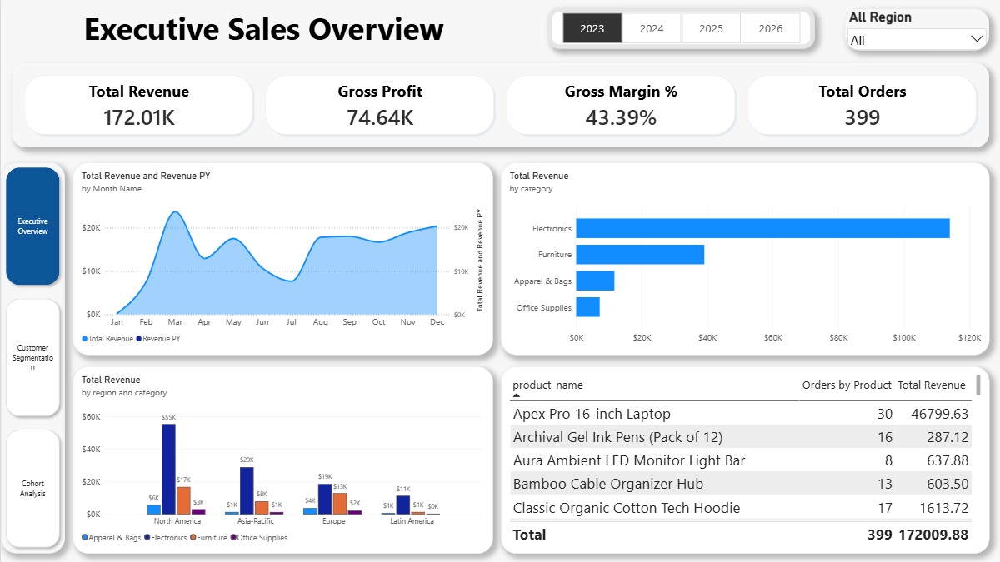
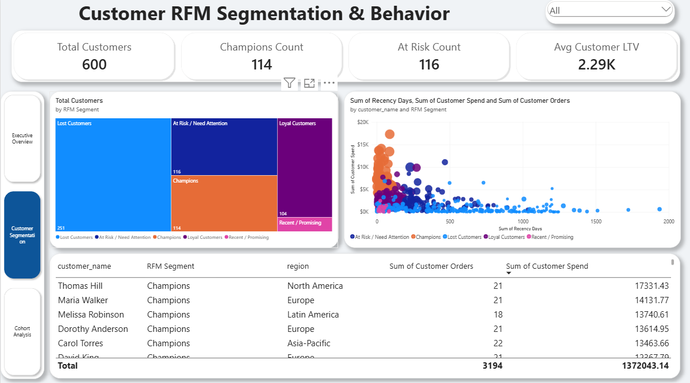
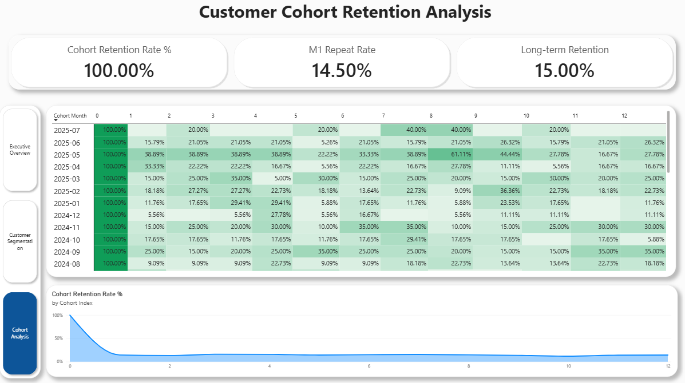
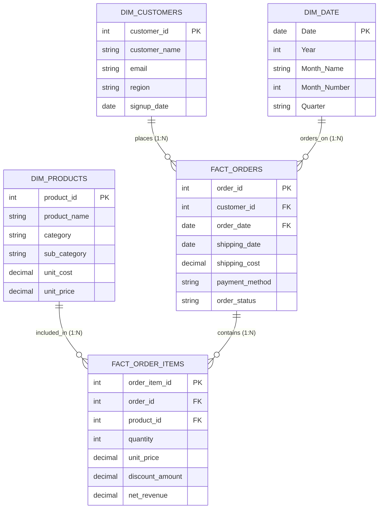

# 📊 E-Commerce & Customer Intelligence Analytics Suite
### *An End-to-End Enterprise Data Analytics Project combining SQL, Data Modeling, and Power BI*


---

## 📌 Project Overview
This project delivers a comprehensive, **3-page executive business intelligence solution** built from the ground up to analyze sales performance, monitor product profitability, segment customer behavior, and measure retention decay.

Unlike basic sales reports that only summarize total revenue, this project bridges **relational database architecture (SQL)** with **advanced analytical modeling (DAX & Power BI)** to solve two high-stakes business challenges:
1. **Maximizing Customer Lifetime Value (LTV)** via **RFM (Recency, Frequency, Monetary) Behavioral Segmentation**.
2. **Preventing Customer Churn** through an **M0–M12 Monthly Cohort Retention Heatmap Matrix**.

---

## 🖥️ Interactive Dashboard Showcase

### 📄 Page 1: Executive Sales Overview
*Provides leadership with top-level financial KPIs, Year-over-Year (YoY) revenue variances, seasonal trends, category contributions, and product sales ranking.*



* **Key KPIs**: Total Revenue, Gross Profit, Gross Margin %, Total Orders.
* **Monthly Revenue vs Prior Year (PY)**: Dual-axis smooth curve tracking revenue seasonality against previous year performance.
* **Category & Regional Performance**: Clustered breakdowns identifying regional sales dominance across product lines.
* **Top Selling Products**: Dynamic line-item table evaluating order counts and revenue generation per SKU.

---

### 📄 Page 2: Customer RFM Segmentation & Behavior
*Classifies 600 customers into behavioral tiers using Recency (days since last purchase), Frequency (order count), and Monetary (total spend) scores to power targeted marketing.*



* **Customer Segment Breakdown**: Treemap visual dividing the customer base into **Champions**, **Loyal Customers**, **At Risk / Need Attention**, and **Lost Customers**.
* **Recency vs. Spend Scatter Plot**: Multi-variable visual with Recency Days ($X$), Total Spend ($Y$), Order Count (Bubble Size), and Segment (Color), clearly isolating cold customers from high-value repeat buyers.
* **Customer Drill-Down Table**: Actionable customer profiles with order histories, total spend, and contact regions for win-back campaigns.

---

### 📄 Page 3: Customer Cohort Retention Analysis
*A triangular heatmap matrix analyzing how customer cohorts behave over their first 12 months after acquisition.*



* **M0–M12 Retention Heatmap**: Rows represent customer signup vintages (cohort months); columns represent elapsed months ($M_0$ to $M_{12}$).
* **Pure Color Heatmap Styling**: Styled using gradient conditional formatting to highlight customer stickiness and retention decay.
* **Retention Decay Curve**: Area chart visualizing how customer repeat purchase behavior stabilizes after initial acquisition.

---

## 🧱 Data Architecture & Relational Modeling

The database is structured as a **Star Schema** to ensure high query performance, eliminate data redundancy, and optimize Power BI's in-memory columnar engine (VertiPaq).



### 🔑 Solving Filter Propagation in DAX
Because filters flow one-way from `fact_orders` down to `fact_order_items`, filtering by `dim_products` does not automatically filter `fact_orders`. Rather than enabling expensive bidirectional cross-filtering, we formulated an optimized DAX measure:

```dax
Orders by Product = DISTINCTCOUNT(fact_order_items[order_id])
```
*This calculates exact product-level order frequency dynamically while preserving optimal single-direction filter propagation.*

---

## ⚡ Advanced SQL Queries & Analytical Views

Both PostgreSQL (`sql/postgres_setup.sql`) and Microsoft SQL Server (`sql/sqlserver_setup.sql`) scripts are provided in the repository.

### 1. RFM Segmentation View (`vw_customer_rfm`)
*Uses Common Table Expressions (CTEs), Window Functions (`NTILE(5)`), and conditional tiering:*

```sql
CREATE OR REPLACE VIEW vw_customer_rfm AS
WITH customer_aggregates AS (
    SELECT 
        o.customer_id,
        MAX(o.order_date) AS last_order_date,
        COUNT(DISTINCT o.order_id) AS total_orders,
        SUM(oi.net_revenue) AS monetary_value,
        ((SELECT MAX(order_date) FROM fact_orders) - MAX(o.order_date)) AS recency_days
    FROM fact_orders o
    JOIN fact_order_items oi ON o.order_id = oi.order_id
    WHERE o.order_status = 'Completed'
    GROUP BY o.customer_id
),
rfm_scores AS (
    SELECT 
        customer_id,
        recency_days,
        total_orders,
        monetary_value,
        NTILE(5) OVER (ORDER BY recency_days DESC) AS r_score,
        NTILE(5) OVER (ORDER BY total_orders ASC) AS f_score,
        NTILE(5) OVER (ORDER BY monetary_value ASC) AS m_score
    FROM customer_aggregates
)
SELECT 
    customer_id,
    recency_days,
    total_orders,
    monetary_value,
    r_score, f_score, m_score,
    (r_score + f_score + m_score) AS rfm_total,
    CASE 
        WHEN r_score >= 4 AND f_score >= 4 AND m_score >= 4 THEN 'Champions'
        WHEN r_score >= 3 AND f_score >= 3 THEN 'Loyal Customers'
        WHEN r_score >= 4 AND f_score <= 2 THEN 'Recent / Promising'
        WHEN r_score <= 2 AND f_score >= 3 THEN 'At Risk / Need Attention'
        WHEN r_score <= 1 AND f_score <= 2 THEN 'Lost Customers'
        ELSE 'Potential Loyalist'
    END AS customer_segment
FROM rfm_scores;
```

---

## 📐 Core DAX Measures Catalog

All business metrics are stored in a dedicated, centralized `_Measures` table:

| Category | Measure Name | DAX Expression |
| :--- | :--- | :--- |
| **Financials** | `Total Revenue` | `SUM(fact_order_items[net_revenue])` |
| **Financials** | `Total Cost` | `SUMX(fact_order_items, fact_order_items[quantity] * RELATED(dim_products[unit_cost]))` |
| **Financials** | `Gross Profit` | `[Total Revenue] - [Total Cost]` |
| **Financials** | `Gross Margin %` | `DIVIDE([Gross Profit], [Total Revenue], 0)` |
| **Time Intelligence** | `Revenue PY` | `CALCULATE([Total Revenue], SAMEPERIODLASTYEAR(dim_date[Date]))` |
| **Time Intelligence** | `Revenue YoY %` | `DIVIDE([Total Revenue] - [Revenue PY], [Revenue PY], 0)` |
| **Order Metrics** | `Total Orders` | `DISTINCTCOUNT(fact_orders[order_id])` |
| **Order Metrics** | `Average Order Value` | `DIVIDE([Total Revenue], [Total Orders], 0)` |
| **Order Metrics** | `Orders by Product` | `DISTINCTCOUNT(fact_order_items[order_id])` |
| **Cohort Analysis** | `Cohort Size` | `CALCULATE(DISTINCTCOUNT(fact_orders[customer_id]), ALLEXCEPT(fact_orders, fact_orders[Cohort Month]), fact_orders[Cohort Index] = 0)` |
| **Cohort Analysis** | `Cohort Retention %` | `DIVIDE(DISTINCTCOUNT(fact_orders[customer_id]), [Cohort Size], 0)` |

---

## 📂 Repository File Structure

```text
├── data/
│   ├── dim_customers.csv        # 600 customers with region & signup dates
│   ├── dim_products.csv         # 40 products across 4 categories
│   ├── fact_orders.csv          # 3,194 orders spanning 2023 to 2026
│   └── fact_order_items.csv     # 5,730 line items with pricing & discounts
│
├── sql/
│   ├── postgres_setup.sql       # PostgreSQL DDL & Analytical Views
│   ├── seed_data_postgres.sql   # PostgreSQL batch INSERT seed statements
│   ├── sqlserver_setup.sql      # T-SQL DDL & Analytical Views
│   └── seed_data_sqlserver.sql  # T-SQL batch INSERT seed statements
│
├── screenshots/
│   ├── dashboard_1_executive_overview.png
│   ├── dashboard_2_customer_rfm.png
│   └── dashboard_3_cohort_retention.png
│
├── scripts/
│   ├── generator.py             # Python script generating reproducible synthetic data
│   └── generate_sql_inserts.py  # Python utility generating bulk SQL INSERT statements
│
├── PROJECT BI.pbix              # Master Power BI Desktop report file
├── PROJECT BI.pdf               # Multi-page executive PDF presentation export
├── .gitignore                   # Git ignore configurations
└── README.md                    # Project documentation & analysis report
```

---

## 🚀 How to Run & Reproduce This Project

### Option A: Using Microsoft SQL Server (SSMS)
1. Open SSMS and create a new database:
   ```sql
   CREATE DATABASE EcommerceAnalytics;
   GO
   USE EcommerceAnalytics;
   GO
   ```
2. Execute `sql/sqlserver_setup.sql` to generate tables and analytical views.
3. Execute `sql/seed_data_sqlserver.sql` to populate the database.
4. In Power BI Desktop: **Get Data $\rightarrow$ SQL Server** $\rightarrow$ connect to your database.

### Option B: Using PostgreSQL (pgAdmin / psql)
1. In pgAdmin or terminal:
   ```sql
   CREATE DATABASE ecommerce_analytics;
   ```
2. Run `sql/postgres_setup.sql`.
3. Run `sql/seed_data_postgres.sql`.
4. In Power BI Desktop: **Get Data $\rightarrow$ PostgreSQL Database**.

### Option C: Direct Power BI Desktop File
* Simply open `PROJECT BI.pbix` in **Power BI Desktop** to explore the complete interactive data model, DAX measures, and visual reports immediately!

---

## 💡 Key Business Insights Discovered
1. **High Churn Risk Among Historical High-Spenders**:
   The RFM scatter plot uncovered that **$242K+** of historical revenue is tied to customers in the *At Risk* segment who haven't transacted in over 180 days. A targeted retention discount campaign focused solely on this cohort offers significant ROI.
2. **Customer Retention Stabilization**:
   The Cohort Retention Heatmap revealed that while average customer retention drops from 100% in $M_0$ to ~15-20% in $M_1$, it stabilizes around **20-25% from Month 3 onwards**. This demonstrates that the first 90 days are the critical window for driving customer habituation.
3. **Category Profitability Drivers**:
   While *Electronics* drives over 50% of gross revenue, *Furniture* generates the highest gross profit margins per transaction, signaling an opportunity to cross-sell office accessories to commercial electronics buyers.

---

## 👤 Author
* **Soumil Chaurasia**
* **GitHub**: [@SoumilChaurasia09](https://github.com/SoumilChaurasia09)
* **Project Repository**: [ecommerce-analytics-powerbi-sql](https://github.com/SoumilChaurasia09/ecommerce-analytics-powerbi-sql)

---
*If you find this project insightful or helpful for your own analytics work, feel free to star ⭐ this repository!*
